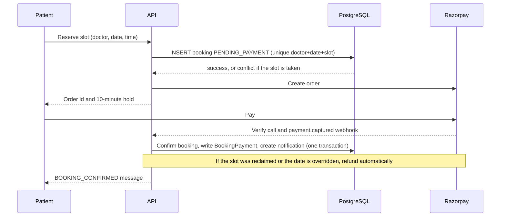

# Clinic Appointment Booking — Multi-Tenant SaaS (Backend)

A multi-tenant SaaS backend where **local clinics subscribe and manage their doctors**, and **patients search clinics by city and book appointment slots online**. Slots are confirmed only after a successful payment, and the booking flow is built to stay correct when many patients try to book the same slot at once.

> **Status:** backend in active development (built in small daily chunks, tested through Postman). Web app only; a frontend is not part of this repository.

---

## Table of contents

- [Highlights](#highlights)
- [Tech stack](#tech-stack)
- [Architecture](#architecture)
- [Roles and access control](#roles-and-access-control)
- [Features](#features)
- [Booking and payment flow](#booking-and-payment-flow)
- [Doctor unavailability and rescheduling](#doctor-unavailability-and-rescheduling)
- [Data model](#data-model)
- [API overview](#api-overview)
- [Security decisions](#security-decisions)
- [Getting started](#getting-started)
- [Testing the payment webhook locally](#testing-the-payment-webhook-locally)
- [Roadmap](#roadmap)
- [Known limitations](#known-limitations)

---

## Highlights

- **Multi-tenant by design:** every clinic is a tenant, and clinic data is scoped by `tenantId` on every query.
- **Concurrency-safe booking:** a database unique constraint on doctor + date + slot, a 10-minute payment hold, and a reserve → pay → confirm flow, so only one patient can ever get a slot.
- **Money-safe edge cases:** a permanent payment ledger and an automatic Razorpay refund when a payment arrives for a slot that someone else already holds.
- **Subscription-gated clinics:** clinics pay a 30-day subscription through Razorpay; inactive or expired clinics are hidden from search and blocked from booking services (HTTP 402).
- **Live-computed availability:** weekly slot templates and per-date overrides are combined on request, with no pre-generated slot rows to keep in sync.
- **Real-world operations:** doctor-unavailability handling with reschedule or cancel-with-refund, staff accounts, visit outcomes, reviews, and an in-app notification inbox.
- **Free-tier friendly:** built to run on free tiers only (Neon, Resend, Razorpay test mode, ngrok).

## Tech stack

| Area | Choice |
| --- | --- |
| Runtime and language | Node.js, TypeScript |
| Framework | Express.js |
| Database | PostgreSQL on Neon (`pg` connection pool) |
| Authentication | JWT in httpOnly, SameSite=Lax cookies |
| Payments | Razorpay (test mode): subscriptions, booking payments, webhooks, refunds |
| Email | Resend |
| Testing | Postman (manual API testing), ngrok for webhook testing |
| Planned | Redis via Upstash, Google Gemini free tier (AI symptom matching) |

## Architecture

The backend is a **modular monolith**: one Express + TypeScript app organised by responsibility rather than split into microservices.

```
src/
├── config/        # database pool and environment setup
├── routes/        # route definitions per domain
├── controllers/   # request handling
├── schemas/       # request validation
├── middlewares/   # auth, role checks, subscription gate, active-user check
└── services/      # business logic: bookings, payments, availability, notifications, reviews
```

Design choices worth knowing:

- **Booking concurrency lives in PostgreSQL**, not in application memory, so it holds across restarts and multiple instances.
- **Availability is computed live** from the weekly template plus overrides, which avoids stale materialised slots.
- **Platform-level Razorpay account for now.** Booking payments currently go to the platform's own account, with per-clinic payouts (Razorpay Route) deferred until linked-account onboarding is possible. `appointmentFeePaise` already exists on the doctor so the schema is ready.
- **DATE handling:** `node-pg` returns `DATE` columns shifted by the local timezone, so `types.setTypeParser(1082)` in `config/db.ts` keeps dates as plain strings (this fixed an IST off-by-one bug).

## Roles and access control

| Role | Who | What they can do |
| --- | --- | --- |
| Patient | Registers as a patient | Search clinics, book and pay for slots, view the inbox, review completed visits, manage own profile |
| Clinic Admin | Registers as a clinic | Everything for their own clinic: profile, doctors, availability and overrides, subscription, staff, bookings, visit outcomes, review responses, reschedule and cancel |
| Clinic Staff (`CLINIC_STAFF`) | Created by the clinic admin | View the clinic's bookings and record a visit outcome once; everything else is admin-only |

Key rules:

- A clinic admin can never edit `subscriptionStatus`; only the payment flow changes it.
- Access checks read the database on every request (`requireActiveUser`, `requireActiveSubscription`), so deactivating a staff account or lapsing a subscription takes effect **immediately**, even with a still-valid cookie.
- Clinics only ever see a booked patient's **name and phone**, nothing else.

## Features

### Accounts and authentication
- Separate registration for **patients** and **clinics** (name, unique email, password).
- **Email OTP verification** with resend; an account cannot proceed until the OTP is verified.
- Login and logout with a JWT stored in an httpOnly, SameSite=Lax cookie.
- **Forgot / reset password:** the same generic response for every email (no account enumeration), a 10-minute single-use hashed code, 5 atomic attempts, a 60-second resend cooldown, and a 30-minute reset lockout after repeated wrong codes. The code endpoints share a 10-requests-per-10-minutes rate limit.
- Patient profile (with optional phone) and clinic profile management, both scoped to the logged-in user.

### Clinic subscriptions
- One-time Razorpay payment that grants **30 days** of service (price and period configured through environment variables).
- `requireActiveSubscription` middleware returns **402** for clinics that are not active.
- Public search and clinic pages only expose clinics with an **active, unexpired** subscription.

### Clinic search
- Public search by city with pagination, plus a clinic detail endpoint.
- Responses use a safe column list that excludes the clinic admin's login email.

### Doctors and availability
- Doctors per clinic with a per-doctor **slot duration** and appointment fee.
- **Weekly availability templates** per weekday, plus **date overrides** that block the weekly template on a given day.
- Slots are computed live for the current calendar week as a shrinking window (already-started times drop off).

### Booking and payments
- Reserve a slot, pay through Razorpay, confirm server-side (verify endpoint and webhook).
- 10-minute hold on a reserved slot, configurable with `BOOKING_HOLD_MINUTES`.
- A permanent **`BookingPayment`** ledger with one row per Razorpay order, which survives a reclaimed slot.
- **Late-payment protection:** if a payment lands for a slot someone else now holds, the order is automatically **refunded** and marked `REFUNDED` with the refund id.

### Clinic operations
- Bookings dashboard for the clinic: confirmed bookings from today onward, filterable by doctor and date range.
- **Staff accounts:** the admin creates, lists, and activates or deactivates staff; staff set their own password through forgot-password.
- **Visit outcomes:** staff or admin record each visit as `COMPLETED` or `NO_SHOW` once the appointment has started. Staff can record it once; only the admin can change it, and not after a review exists. The outcome is stored in its own column, so the booking status is untouched.

### Reviews and ratings
- Separate **clinic** and **doctor** reviews, allowed only for `COMPLETED` visits.
- One review per booking per target; patients can edit, and averages are recomputed on every change.
- One **admin response** per review.
- Public listings never reveal the patient's identity, and the respond endpoint returns only public columns.

### Notifications
- In-app inbox: list, unread count, mark as read, mark all as read, scoped per user and available even when a clinic's subscription is inactive.
- Types in use: `BOOKING_CONFIRMED` (doctor, clinic, date and time, address and a Google Maps link), `REVIEW_REQUEST`, `DOCTOR_UNAVAILABLE`, `APPOINTMENT_RESTORED`.
- The confirmation message is written **inside the same transaction** that confirms the booking.
- Delivered by plain HTTP polling for now; server-sent events are planned.

## Booking and payment flow



A booking moves through `PENDING_PAYMENT` → `CONFIRMED`, and can end in `CANCELLED` (admin cancel with refund). The visit result (`COMPLETED` or `NO_SHOW`) is tracked separately.

## Doctor unavailability and rescheduling

When a doctor becomes unavailable on a date:

1. Adding a **date override** flags every confirmed, not-yet-started booking on that date (`needsReschedule`), sends each patient a `DOCTOR_UNAVAILABLE` message, and lists the affected bookings (patient name and phone only) to the admin.
2. The admin contacts the patient, then uses the admin-only endpoints under `/api/clinics/me/bookings/:id`:
   - **`reschedule-options`** lists free slots for a chosen date (`?date=YYYY-MM-DD`) for the same doctor, or another doctor with the same fee.
   - **`reschedule`** moves the booking to a new slot; the change is recorded in a `BookingReschedule` history table and the flag is cleared.
   - **`cancel-with-refund`** cancels the booking, refunds the payment through Razorpay, and makes the slot bookable again.
3. Removing the override clears the flags and sends `APPOINTMENT_RESTORED`.
4. A payment that arrives for a date that became overridden is refused and refunded automatically.

Only flagged bookings can be rescheduled, and any future date is allowed.

## Data model

Main tables (names as used in the database):

| Table | Purpose |
| --- | --- |
| `Tenant` | A clinic; holds the subscription status and expiry |
| Users | Patients, clinic admins and `CLINIC_STAFF`, with active flag and role |
| `Doctor` | Doctor of a clinic, with slot duration and `appointmentFeePaise` |
| `DoctorWeeklyAvailability` | Weekly template (`dayOfWeek`, `startTime`, `endTime`) |
| `DoctorDateOverride` | Date-specific blocks that override the template |
| `Booking` | The appointment: status, `needsReschedule`, visit outcome, payment id; unique on doctor + date + start time |
| `BookingPayment` | Permanent payment ledger, one row per Razorpay order, with refund state |
| `BookingReschedule` | History of reschedules |
| Reviews | Clinic and doctor reviews with admin responses |
| `Notification` | In-app inbox messages |

## API overview

All routes are under `/api`. Authentication uses the cookie set at login.

| Area | Method and path | Access |
| --- | --- | --- |
| Clinic search | `GET /api/clinics/search?city=&page=` | Public |
| Clinic detail | `GET /api/clinics/:id` | Public |
| Clinic profile | `GET`, `PUT /api/clinics/me` | Clinic admin |
| Staff | `POST /api/clinics/me/staff` (plus list and activate/deactivate) | Clinic admin |
| Bookings dashboard | `GET /api/clinics/me/bookings` | Clinic admin, staff |
| Visit outcome | `PATCH /api/clinics/me/bookings/:id/visit` | Clinic admin, staff |
| Reschedule options | `GET /api/clinics/me/bookings/:id/reschedule-options?date=` | Clinic admin |
| Reschedule | `POST /api/clinics/me/bookings/:id/reschedule` | Clinic admin |
| Cancel with refund | `POST /api/clinics/me/bookings/:id/cancel-with-refund` | Clinic admin |
| Patient profile | `GET`, `PUT /api/patients/me` | Patient |

Registration, OTP, login, password reset, availability, reservation, payment verification, reviews and notifications follow the same pattern; check the `routes/` folder for the exact paths.

## Security decisions

- httpOnly, SameSite=Lax cookie instead of a bearer token (web app only).
- Per-request database checks for subscription state and account activity, so revocation is immediate.
- Reset and OTP codes are hashed, single-use, attempt-limited and rate-limited; the reset flow never reveals whether an email exists.
- Responses use explicit safe column lists; patient identity is never exposed in public reviews, and clinics see only name and phone.
- Subscription status is writable only by the payment flow.
- Money paths are idempotent by design: one ledger row per order, conditional updates when reclaiming slots, and refunds for any payment that cannot be honoured.

## Getting started

### Prerequisites

- Node.js (LTS) and npm
- A free [Neon](https://neon.tech) PostgreSQL database
- A Razorpay account in **test mode**
- A [Resend](https://resend.com) API key (optional in development; see below)
- [ngrok](https://ngrok.com) for webhook testing

### Setup

```bash
git clone https://github.com/tanzeem-source/clinic_appointment_booking_MultiTenant_SaaS_Backend.git
cd clinic_appointment_booking_MultiTenant_SaaS_Backend
npm install
cp .env.example .env     # then fill in the values below
npm run dev
```

### Environment variables

Names below are illustrative; match them to your `.env` file.

```env
PORT=5000
DATABASE_URL=postgres://...                # Neon connection string
JWT_SECRET=change-me

RAZORPAY_KEY_ID=rzp_test_xxx
RAZORPAY_KEY_SECRET=xxx
RAZORPAY_WEBHOOK_SECRET=xxx

SUBSCRIPTION_PRICE_PAISE=...               # clinic subscription price
SUBSCRIPTION_PERIOD_DAYS=30
BOOKING_HOLD_MINUTES=10
RESET_LOCKOUT_MINUTES=30

RESEND_API_KEY=re_xxx
```

### Database

Run the SQL schema against your Neon database, including the `Booking` status check that allows `CANCELLED` and the `BookingReschedule` table.

### Development note on emails

Resend's sandbox delivers only to the account owner's address. Until a sending domain is verified, OTPs and reset codes are **printed to the server console** in development.

## Testing the payment webhook locally

1. Start the server, then run `ngrok http <PORT>`.
2. In the Razorpay dashboard (test mode), add a webhook pointing to `https://<your-ngrok-url>/<webhook-route>` for the `payment.captured` event, and put its secret in `RAZORPAY_WEBHOOK_SECRET`.
3. Make a test booking payment and confirm the booking becomes `CONFIRMED` and a `BookingPayment` row is written.
4. To check the late-payment path, let a hold expire or have another patient take the slot, then pay for the original order; it should be marked `REFUNDED` with a refund id.

## Roadmap

Done: registration and OTP, subscription gate and Razorpay payments, search, availability, concurrency-safe booking with refunds, reviews, notifications inbox, bookings dashboard, password reset, staff accounts, visit outcomes, doctor-unavailability handling, and admin reschedule and cancel-with-refund.

Next:

- Subscription lapse handling, including how already-paid future bookings are treated
- Invoices that patients and clinics can download
- Search improvements and clinic photos
- Live slot updates (server-sent events)
- Auth hardening, including revoking existing sessions after a password reset
- Redis caching (Upstash) for OTP storage and rate limiting, and city-search caching
- Email delivery once a sending domain is verified
- Razorpay Route for per-clinic payouts
- Automated tests and deployment preparation
- **AI symptom matching:** suggest the right specialty from a patient's symptoms using a free-tier LLM API

## Known limitations

- Booking payments go to the platform's Razorpay account until Razorpay Route onboarding is available.
- Notifications use polling, not push.
- Existing sessions are not revoked when a password is reset (planned for the auth hardening work).
- Emails are not delivered to arbitrary addresses until a Resend domain is verified.
- Automated test coverage is not in place yet; the API has been verified manually with Postman.

## Author

**Tanzeem Alam** — [GitHub](https://github.com/tanzeem-source) · [LinkedIn](https://linkedin.com/in/tanzeem-fsdev)
